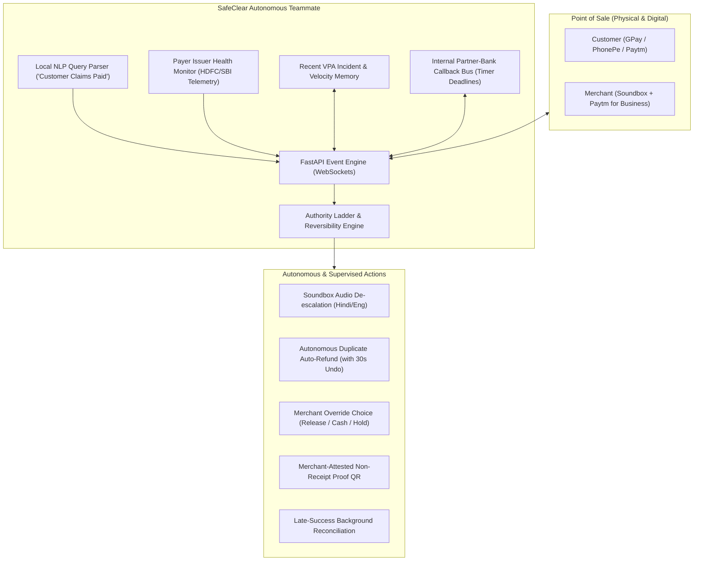
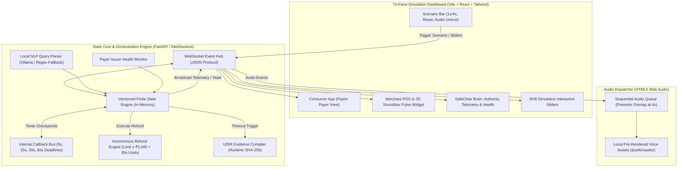

# Paytm SafeClear: Production-Grade Execution Plan (Final Frozen Specification - v5)

**Event:** Paytm Build for India AI Hackathon – Offline Final Round  
**Venue:** Paytm, SkymarkOne, Sector 98, Noida, Uttar Pradesh 201304  
**Date:** October 30, 2026  
**Track:** [Track 3: Autonomous AI Teammates](file:///Users/test/Work/paytm/Problem%20statement%203.pdf)  
**Team:** Team Ok Paytm  
**Project:** [Paytm SafeClear](file:///Users/test/Work/paytm/Paytm%20SafeClear.pdf) (Autonomous Incident Resolution Teammate for Ambiguous POS UPI Transactions)  
**Status:** **FROZEN FOR IMPLEMENTATION**

---

## 1. Executive Summary & Track 3 Autonomous Teammate Scorecard

Paytm SafeClear is an **Autonomous Operational AI Teammate** engineered to eliminate counter friction during in-flight, ambiguous Point-of-Sale UPI payments.

SafeClear is architected around Track 3’s core evaluation rubric:

| Track 3 Rubric Element | How SafeClear Fulfills It | Live Demo Implementation |
| :--- | :--- | :--- |
| **Real Action-Taking** | Autonomous financial and physical counter actions. | **Autonomous Duplicate Auto-Refund** via Merchant Refund API ($\le ₹2,000$), Order-ID Idempotency, and counter order locks. |
| **Autonomy with Guardrails** | Strict 3-tier **Authority Ladder** enforcing policy limits. | Autonomous for low-risk actions; forces merchant confirmation above financial thresholds. |
| **Reversibility & Undo** | Prevents erroneous actions with real undo capability. | **30-Second Refund Cancel Window** on POS: merchant can tap to abort refund if customer intentionally bought a second item. |
| **Human-in-the-Loop** | Resolves counter deadlocks via structured merchant agency. | At 60s timeout, POS prompts: `[Release Goods]` vs `[Take Cash + Auto-Refund UPI]` vs `[Hold Queue]`. |
| **Measurable KPIs** | Parameterized before-and-after baseline model. | **Shift Simulation Panel** (100,000 txns scaled batch) with live sliders (including **Dynamic QR Share** & **De-escalation Effectiveness**). |
| **Context & Memory** | Real-time environment telemetry and contextual history. | **Payer Issuer Health Monitor** (tracking degraded bank CBS) + **Local NLP Parser** (Ollama/Regex) + Recent VPA Incident Memory. |
| **Auditability & Proof** | Tamper-evident cryptographic verification and compliance handoff. | Runtime SHA-256 `event_log_hash`, HMAC signature, and **Merchant-Attested Proof of Non-Receipt QR**. |



---

## 2. Problem Framing, Sizing & The Paytm Counter Moat

### 2.1 The Two Realities: Dynamic QR vs. Static QR
A core requirement for technical credibility before Paytm payment architects is explicitly separating the two counter flows:

```
┌─────────────────────────────────────────────────────────────────────────────────────────────┐
│                               PAYTM SAFECLEAR OPERATING MODES                               │
├──────────────────────────────────────────────┬──────────────────────────────────────────────┤
│ 1. DYNAMIC QR / POS / PAYTM APP PAYERS       │ 2. STATIC QR STAND + THIRD-PARTY PAYERS     │
│    (Proactive Prevention Mode)               │    (Autonomous Cure & Triage Mode)           │
├──────────────────────────────────────────────┼──────────────────────────────────────────────┤
│ • In-flight trigger: order unpaid AND        │ • Paytm receives zero signal until partner-  │
│   (credit leg seen in-flight, OR merchant    │   bank webhook lands.                        │
│   taps 'customer says paid', OR Paytm payer  │ • Soundbox remains silent until webhook.     │
│   PSP signal).                               │ • AUTONOMOUS CURE ACTIONS:                   │
│ • Order-ID Idempotency: Duplicate scans on   │   - Duplicate Auto-Refund:                   │
│   same dynamic QR auto-refunded immediately. │     Rule: P2.initiated_at < P1.confirmed_at  │
│ • PROACTIVE ACTIONS:                         │   - NLP "Customer Claims Paid" Search.       │
│   - Soundbox speaks holding warning.         │   - Merchant-Attested Non-Receipt Proof QR.  │
│   - POS order locks against re-scans.        │                                              │
│   - Fast-loop callback monitoring (0-60s).   │                                              │
└──────────────────────────────────────────────┴──────────────────────────────────────────────┘
```

* **Paytm’s Merchant Moat:** While PhonePe and Google Pay process >80% of consumer-initiated UPI volume, Paytm owns the **counter anchor**: the **Paytm Soundbox** and the **Paytm for Business app**. SafeClear leverages this merchant-side ownership to provide prevention on dynamic QR and automatic cure on static QR.

### 2.2 Sizing Model (Illustrative Modeling Assumptions)
*Based on illustrative assumptions reflecting industry peak retail dynamics:*
* **Paytm Offline P2M Volume (Assumed Baseline):** ~50,000,000 transactions/day.
* **Ambient Latency & Deemed Rate (Assumption):** ~1.2% (~600,000 transactions/day entering temporary in-flight state).
* **Retry Panic Rate (Assumption):** ~25% of unconfirmed payments prompt the customer to attempt a second scan (~150,000 retry attempts/day).
* **Downstream Cost:** Every accidental double-debit creates counter deadlock (75–120s queue delay), redundant manual app refreshes, and expensive bank dispute handling.

---

## 3. Four Core Live Demonstration Scenarios

The simulator includes top-bar **Speed Controls (1x / 4x)**, a **Reset Button**, an **Audio Queue Dispatcher**, and an **AudioContext Unlock ("Start Demo")** button.

```mermaid
sequenceDiagram
    autonumber
    actor Customer as Customer (Paytm / GPay)
    actor Merchant as Merchant (Soundbox & POS)
    participant SafeClear as SafeClear Autonomous Engine
    participant PartnerBank as Partner PSP Bank / Gateway Mock

    Note over Customer,Merchant: Scenario 1: Late Success (Dynamic QR / POS Order)
    Customer->>Merchant: Scans Dynamic QR & Authorizes ₹250
    SafeClear->>Merchant: Soundbox: "₹250 ka payment jaanch mein hai, kripya dobara scan na karein, saamaan abhi na dein"
    SafeClear->>Merchant: POS Order locked: HOLDING (Anti-Duplicate Guard Active)
    SafeClear->>PartnerBank: Internal Callback Watch (t=12s) -> Webhook: SUCCESS (RRN: 329048102941)
    SafeClear->>Merchant: Soundbox Chime: "Paytm par do sau pachaas rupaye prapt hue"
    SafeClear->>Merchant: POS: Order Settled; Counter Queue Released

    Note over Customer,Merchant: Scenario 2: Definitive Failure (Customer Bank Decline)
    Customer->>Merchant: Scans Dynamic QR for ₹500
    SafeClear->>Merchant: Soundbox: "₹500 payment verifying..."
    SafeClear->>PartnerBank: Callback Watch (t=15s) -> Webhook: FAILURE (UPI Code: U30 / Bank Declined)
    SafeClear->>Merchant: Soundbox: "₹500 payment fail hua. Agar paise kate hain to T+1 mein wapas aayenge. Naya payment le sakte hain."
    SafeClear->>Merchant: POS displays Non-Receipt Proof QR; safe to prompt customer for retry

    Note over Customer,Merchant: Scenario 3: Bank Timeout & Counter Release (Human-in-the-Loop)
    Customer->>Merchant: Scans Dynamic QR for ₹1,200
    SafeClear->>Merchant: Soundbox: "₹1,200 verifying..."
    SafeClear->>PartnerBank: Callbacks time out across internal deadlines (5s, 15s, 30s, 60s)
    SafeClear->>SafeClear: t=60s: Transition to UNRESOLVED_COUNTER_RELEASED
    SafeClear->>Merchant: Soundbox: "₹1,200 ka payment abhi confirm nahi hua. Screen par option chunein."
    SafeClear->>Merchant: POS Prompts Merchant Decision: [1. Release Goods] [2. Take Cash + Auto-Refund UPI] [3. Hold Queue]
    Merchant->>SafeClear: Taps "Take Cash + Auto-Refund UPI if lands"
    SafeClear->>SafeClear: Synthesizes UDIR Dispute Docket (Acq Ref: ACQ-REF-20261030-883921 + Telemetry)
    SafeClear-->>SafeClear: [Background Slow Loop: If payment settles at t=3min -> Auto-refunds UPI back to customer]

    Note over Customer,Merchant: Scenario 4: Accidental Duplicate Payment (Static QR - Autonomous Cure)
    Customer->>Merchant: Customer scans Static QR for ₹400 (Payment 1 - In-Flight)
    Customer->>Merchant: Panicked customer scans AGAIN for ₹400 while P1 is pending (Payment 2)
    PartnerBank->>SafeClear: Webhook 1 Lands: P1 SUCCESS (₹400, RRN: 402918231011, init_t: 10:00:15, conf_t: 10:00:45)
    SafeClear->>Merchant: Soundbox Chime: "Paytm par ₹400 prapt hue"
    PartnerBank->>SafeClear: Webhook 2 Lands: P2 SUCCESS (₹400, RRN: 402918231089, init_t: 10:00:30, conf_t: 10:00:50)
    SafeClear->>SafeClear: Guard Check: P2.initiated_at (10:00:30) < P1.confirmed_at (10:00:45) -> CONFIRMED DUPLICATE
    SafeClear->>Merchant: Soundbox: "Duplicate payment mila. ₹400 refund 30 second mein shuru hoga."
    SafeClear->>Merchant: POS: Displays 30-Second Refund Countdown [Tap to Cancel Refund]
    SafeClear->>PartnerBank: Countdown expires -> Executes Merchant Refund API for P2
    SafeClear->>Merchant: Soundbox: "Duplicate payment detected. ₹400 customer ko auto-refund initiate kar diya gaya."
    SafeClear->>Merchant: POS Ledger shows: ₹400 Accepted | ₹400 Refunded (Audit Logged)
```

---

## 4. Track 3 Multipliers: Authority Ladder & Shift Simulation

### 4.1 The Autonomous Authority Ladder & 30s Undo Window
Judges score Track 3 heavily on **safety guardrails, graduated authority, and reversible actions**:

| Authority Level | Permitted Actions | Guardrails & Limits | Reversibility / Undo Mechanism |
| :--- | :--- | :--- | :--- |
| **Level 1: Autonomous (No Human Needed)** | • Soundbox voice warning (Dynamic QR)<br>• Lock POS order / hold screen<br>• Internal callback monitoring<br>• **Duplicate Auto-Refund**<br>• Dispute evidence compilation | **Financial Ceiling:** Auto-refund $\le ₹2,000$.<br>**Initiation Guard:** `P2.initiated_at < P1.confirmed_at`.<br>**Velocity Cap:** Max ₹5,000/day per merchant. | **30-Second Undo Window:** POS shows a 30s countdown bar with `[Cancel Refund]` if customer bought two items intentionally. |
| **Level 2: Human-in-the-Loop (Merchant Decision)** | • Duplicate refund confirmation ($> ₹2,000$ or P2 initiated after P1 settled)<br>• Counter release choice: `[Release Goods]` vs `[Take Cash + Auto-Refund UPI]` vs `[Hold Queue]` | Merchant must tap 1-click decision on POS app or provide verbal confirmation. | Action logged in local state; merchant can modify override choice prior to regulatory batch close. |
| **Level 3: Operations Escalation (Paytm Ops / UDIR)** | • High-value dispute docketing ($> ₹10,000$)<br>• Chronic bank outage escalation<br>• Cross-bank reconciliation logging | Transmitted securely to Paytm dispute queues and customer app grievance records. | Full immutable audit trail with SHA-256 event hash chain and HMAC signature. |

### 4.2 Shift Simulation Panel (Interactive 100,000 Transactions Model)
To demonstrate concrete ROI without hardcoded claims or statistical noise from small samples, the dashboard features an interactive **Shift Simulation Panel** running a scaled batch of 100,000 peak transactions. Judges adjust parameters via live sliders:
* **Interactive Sliders:**
  * **Dynamic QR Share ($10\% - 90\%$, default: $40\%$)**
  * Ambient Ambiguity Rate ($0.5\% - 5.0\%$, default: $1.5\%$)
  * Retry Panic Rate ($10\% - 50\%$, default: $25\%$)
  * **SafeClear De-escalation Effectiveness ($30\% - 90\%$, default: $70\%$)**
  * Payer Issuer Timeout Share ($1\% - 10\%$, default: $2\%$)
* **Live Computed Metrics (Model Output under Current Assumptions):**
  * **Duplicate Incidents Prevented:** Calculated dynamically as:
    $$\text{Duplicates Prevented} = N \times \text{AmbiguityRate} \times \text{RetryPanicRate} \times \text{DeescalationEffectiveness} \times \text{DynamicShare}$$
  * **Counter Latency Reduction:** Live comparison of baseline queue hold time vs SafeClear automated de-escalation under the current parameter set.
  * **Merchant Overhead:** Pull-to-refresh app interactions reduced to zero.
  * **Automated Financial Restitution:** Total value of duplicate payments autonomously refunded within policy limits.
  * *UI Label:* *"Simulated Model Output — Scaled Batch (100,000 Transactions) under user-defined assumptions"*.

### 4.3 AI & Context Components (Local Offline Execution)
1. **Local NLP Query Extractor ("Customer Claims Paid" Flow):**
   * Merchant types query (or selects preset quick-chips): *"Customer bol raha hai 500 bheja 2 min pehle"* or *"500 received phonepe"*.
   * Executed via local small model (Ollama `qwen2.5:1.5b` pre-warmed at boot) with deterministic regex fallback.
   * Telemetry logs which engine parsed the input: `parser_engine: "local_ollama_qwen1.5b"` vs `regex_fallback`.
   * **The "Not Found" Branch & Collision Guard:** If no matching unassigned webhook exists in recent buffer $\rightarrow$ POS prompts: *"No payment found. Ask customer for 12-digit UTR"* $\rightarrow$ Merchant enters last 4 digits $\rightarrow$ SafeClear matches on **Last 4 digits + Amount + Time Window (±5 min)** and arms a 90-second listener for that incoming UTR.
2. **Payer Issuer Health Monitor:**
   * Tracks rolling deemed/timeout rate and p95 latency for major payer banks (HDFC, SBI, ICICI, Axis).
   * **Adaptive Action:** When an issuer's deemed rate exceeds $15\%$, SafeClear warns the merchant (*"HDFC UPI network degraded"*), recommends cash/alternative app, and **shortens the holding threshold from 60s to 30s** to avoid holding the counter during systemic bank outages.
3. **Recent VPA Incident & Velocity Memory:**
   * Maintains local state memory of recent transactions per VPA: flags rapid repeat attempts and surfaces repeat-customer history in the incident telemetry view.

---

## 5. System Architecture & Technical Realism



### 5.1 Paytm’s Payment Architecture & Partner Banks
* **Paytm’s Role:** Operates as a **Payment Aggregator and TPAP**, partnering with major acquiring banks (**Yes Bank, Axis Bank, HDFC Bank, SBI**). Paytm does not operate an independent merchant CBS.
* **Internal Callback Bus:** SafeClear monitors Paytm's internal partner-bank callback ingestion queues. Checkpoints at $t=5s, 15s, 30s, 60s$ evaluate whether incoming webhooks have arrived, consuming zero external NPCI API quotas.
* **External Gateway Reconciliation ($\ge 90$ seconds):** Formal external `ChkTxn` inquiries are initiated only during regulatory reconciliation cycles.

### 5.2 Third-Party Payers & Merchant-Attested Non-Receipt Proof QR
Because Paytm cannot touch GPay/PhonePe payer screens or dispatch SMS without customer contact details, SafeClear generates a **Merchant-Attested Proof of Non-Receipt QR Code on the Merchant POS Screen**:
* **Payload:** Merchant VPA, Terminal ID, Acquirer Reference ID, Timestamp, Amount, Status: `UNCREDITED_AT_TERMINAL`, and `hmac_signature`.
* **Value to Customer:** Ends the counter standoff with a timestamped, signed record that the merchant did not receive the funds, which the customer can attach if they raise a dispute in their UPI app.

### 5.3 Official Response Codes & Cryptographic Docket
* **UPI & Transport Codes:**
  * `00`: Approved / Success.
  * `Z9`: Insufficient funds.
  * `ZM`: Invalid UPI PIN.
  * `U30`: Transaction declined / debit failed.
  * For unresolved timeouts: `upi_code: null`, `transport_code: "HTTP_504_GATEWAY_TIMEOUT"`.
* **Runtime-Computed Cryptographic Docket:**
  Hashes are computed **at runtime** across the canonical JSON event log:
  ```json
  {
    "docket_id": "UDIR-SAFECLEAR-20261030-99412",
    "timestamp": "2026-10-30T11:42:15.102Z",
    "merchant_vpa": "paytm-retail-9821@paytm",
    "customer_masked_vpa": "rahul****@okhdfcbank",
    "amount": 1200.00,
    "currency": "INR",
    "acquirer_ref": "ACQ-REF-20261030-883921",
    "event_count": 6,
    "event_log_hash": "<computed_sha256_at_runtime>",
    "hmac_signature": "<computed_hmac_sha256_at_runtime>",
    "last_gateway_status": {
      "transport_code": "HTTP_504_GATEWAY_TIMEOUT",
      "upi_code": null
    },
    "terminal_telemetry": {
      "soundbox_id": "SBX-NCR-8820",
      "firmware_version": "v3.1.4-sc",
      "rssi_dbm": -68
    },
    "escalation_route": "MERCHANT_ATTESTED_NON_RECEIPT_QR",
    "regulatory_framework": "RBI DPSS.CO.PD No.629/02.01.014/2019-20"
  }
  ```

---

## 6. Offline Hackathon Sprint Schedule & Team Roles

```mermaid
gantt
    title October 30 Offline Hackathon Build Schedule
    dateFormat  HH:mm
    axisFormat %H:%M

    section Walking Skeleton
    Setup & Freeze WebSocket Schema       :09:00, 45m
    Pre-Rendered Audio Check (/public/audio/) :09:45, 45m
    Walking Skeleton: Scenario 1 End-to-End :10:30, 120m

    section Parallel Streams (12:30 - 16:30)
    Eng 1 (Backend): FSM, Duplicate Refund & Hashes :13:30, 120m
    Eng 1 (Backend): Shift Sim Scaled Batch Engine  :15:30, 60m
    Eng 2 (Frontend): 2D Soundbox Pulse & POS UI    :13:30, 120m
    Eng 2 (Frontend): Sim Sliders & Audio Queue     :15:30, 60m
    Eng 3 (AI/Context): NLP Parser & Issuer Health  :13:30, 120m
    Eng 3 (Pitch/Test): Edge Tests & Decision Modals:15:30, 60m

    section Polish & Rehearsal (16:30 - 19:30)
    Integrated Testing (All 4 Scenarios)            :16:30, 60m
    Pitch Dry-Run & Judge Defense Rehearsal         :17:30, 60m
    Backup 60fps Screen Recording Capture           :18:30, 45m
```

### Team Roles (3-Person Team)
* **Engineer 1 (Backend Core & Simulation):** FastAPI state machine, WebSocket hub, duplicate refund logic with 30s cancel buffer, runtime SHA-256 docket generator, and scaled shift simulation.
* **Engineer 2 (Frontend & Audio UI):** Vite + React tri-pane layout, 2D Soundbox pulsing widget, sequential audio queue (clean 4x playback), speed controls, and interactive sliders.
* **Engineer 3 / Lead (AI, Context & Pitch):** Local NLP query parser, Payer Issuer Health monitor, merchant decision modals, RRN QR generator, edge testing, and pitch delivery.

---

## 7. Revised 3-Minute Live Pitch Choreography

### [00:00 - 00:30] The Hook: The Real Counter Chaos
> *"Judges, every day hundreds of thousands of UPI transactions enter network latency limbo. The customer’s bank debits the money, but the merchant’s Soundbox stays completely silent.  
> What happens at the counter? The customer panics and scans again—causing an accidental double-debit. The merchant stops the queue to refresh their app.  
> Existing apps just show 'Payment processing'. We built **Paytm SafeClear**, an autonomous AI teammate that takes operational ownership of the physical counter during those critical 60 seconds."*

### [00:30 - 01:45] The 4 Core Live Scenarios (Speed Controls: 1x / 4x)
*(Click "Start Demo" to unlock AudioContext. Trigger Scenario 1 at 4x)*
> *"Watch our tri-pane dashboard. On the left is the consumer view; in the center is the merchant POS with our Soundbox; on the right is SafeClear's event engine.  
> **Scenario 1:** ₹250 on a dynamic QR. The order stays unpaid and the partner-bank credit leg is pending, so SafeClear moves the counter to hold. The Soundbox speaks: [Audio: '₹250 ka payment jaanch mein hai, kripya dobara scan na karein, saamaan abhi na dein']. The POS locks the order. When our internal partner-bank callback lands at second 12, the Soundbox chimes and the queue is released."*

*(Trigger Scenario 4: Accidental Duplicate Payment on Static QR)*
> *"Now **Scenario 4: The Static QR Dilemma.** On a static QR, Paytm receives no signal until webhooks land. What happens if an anxious customer scans twice? Watch SafeClear’s autonomous cure. Payment 1 succeeds. When Payment 2 arrives, SafeClear checks timestamps: Payment 2 was initiated before Payment 1 confirmed. The Soundbox warns: [Audio: 'Duplicate payment mila. ₹400 refund 30 second mein shuru hoga']. SafeClear opens a **30-second cancellation window** on the POS for the merchant, then autonomously initiates the **Merchant Refund API**. The refund reference shows on the merchant POS, with minimal merchant intervention."*

*(Trigger Scenario 3: Bank Timeout & Human-in-the-Loop)*
> *"Now **Scenario 3: Prolonged Bank Outage.** At 60 seconds, SafeClear transitions to `UNRESOLVED_COUNTER_RELEASED`. The Soundbox announces: [Audio: '₹1,200 ka payment abhi confirm nahi hua. Screen par option chunein.']. The merchant gets three supervised override choices: [Release Goods], [Take Cash + Auto-Refund UPI], or [Hold Queue]. If the merchant takes cash, SafeClear marks the transaction to auto-refund the UPI credit whenever background reconciliation completes, and generates an audit-ready UDIR evidence docket with terminal telemetry."*

### [01:45 - 02:30] Track 3 Proof: The Shift Simulation Panel
*(Navigate to Shift Simulation tab)*
> *"To prove SafeClear is a true operational teammate and not just a script, look at our **Shift Simulation Panel**. Here, judges can adjust real-world dynamic QR share, ambiguity, retry panic, and our Soundbox de-escalation effectiveness. Running a 100,000-transaction scaled batch under these live assumptions:  
> - Watch the numbers update live on screen: duplicate payments drop sharply.  
> - Counter wait time falls substantially under automated de-escalation.  
> - The vast majority of in-flight ambiguity incidents are resolved autonomously without human ops."*

### [02:30 - 03:00] Business Impact & Close
> *"SafeClear transforms Paytm Soundbox from a passive speaker into an active, intelligent counter teammate. It protects merchant queue speed, substantially reduces duplicate payment disputes, and preserves counter trust. We are Team Ok Paytm, and SafeClear makes every counter friction-free."*

---

## 8. Complete Judge Q&A Defense Matrix

| Question | Trap / Intent | Your Winning Defense |
| :--- | :--- | :--- |
| **"On a static QR with GPay/PhonePe, Paytm has no in-flight signal. How can your Soundbox speak a holding warning?"** | Testing honesty & deep payment plumbing knowledge. | *"It doesn't—and that is an architectural reality we respect. On a **Dynamic QR or POS order**, SafeClear acts in **Proactive Prevention Mode** (voice warning + order lock + order-ID idempotency). On a **Static QR with third-party payers**, SafeClear acts in **Autonomous Cure Mode**: it detects duplicate spend via webhook timestamps (`P2.initiated < P1.confirmed`), executes duplicate auto-refunds with a 30s undo window, provides NLP search for claimed payments, and generates a Merchant-Attested Non-Receipt Proof QR."* |
| **"What happens if a payment succeeds after your 60-second counter release?"** | Testing edge-case lifecycle ownership across merchant choices. | *"It depends on the merchant's supervised choice at second 60:  
1. If the merchant chose **Take Cash + Auto-Refund UPI**: SafeClear automatically refunds the incoming UPI credit back to the customer.  
2. If the merchant chose **Release Goods**: The ledger updates to settled and the merchant keeps the money. If it later permanently fails, SafeClear notifies the merchant, surfaces the RRN and masked VPA for follow-up, and logs the uncollectible loss.  
3. If the merchant chose **Hold Queue**: The Soundbox chimes and goods are released upon receipt."* |
| **"What prevents an unconditional auto-refund from refunding a legitimate second purchase (e.g., buying two ₹20 chais)?"** | Testing false-positive edge cases. | *"Two layers of defense:  
1. SafeClear only auto-refunds if `P2.initiated_at < P1.confirmed_at`. If P2 was initiated after P1 was confirmed, SafeClear asks the merchant on the POS to confirm.  
2. Even when triggered, SafeClear announces a 30s delay and displays a **30-Second Refund Cancellation Window** on the POS, allowing the merchant to cancel the refund with one tap."* |
| **"Could a customer play a fake recording of the Soundbox warning on their phone to walk away with goods?"** | Testing fraud resistance. | *"The merchant trusts only **their own physical Paytm Soundbox and POS terminal state**, never customer phone speakers. Furthermore, SafeClear explicitly announces: '...saamaan abhi na dein' (do not release goods yet). Goods are released only when the definitive Paytm success chime sounds."* |
| **"What does the Merchant-Attested Non-Receipt QR do that the customer's UPI app doesn't?"** | Testing consumer dispute handoff realism. | *"The customer's UPI app gets status from NPCI, but disputes often drag out when merchants dispute receipt. The **Non-Receipt Proof QR** ends the counter standoff with a timestamped merchant-side record with terminal telemetry and status `UNCREDITED_AT_TERMINAL` that the customer can attach if they raise a complaint."* |
| **"Why is this an Autonomous Teammate rather than a conventional rule-based cron job?"** | Core Track 3 rubric test. | *"A cron job runs on static timers with no context or action-taking. SafeClear operates as an autonomous teammate: it operates within a **strict 3-tier Authority Ladder with 30s reversibility**, executes **active financial restitution** (Duplicate Auto-Refund), interprets **natural language queries** ('Customer claims paid 500'), and maintains **contextual awareness of payer issuer bank health** to adapt holding windows dynamically."* |

---

## 9. Offline Resilience & Failsafe Checklist

- [ ] **100% Localhost Execution:** Entire stack (`Vite:5173` + `FastAPI:8000`) runs locally with laptop Wi-Fi turned completely OFF.
- [ ] **Pre-Pull Ollama Model:** Run `ollama pull qwen2.5:1.5b` before arriving at the venue. Warm up with a dummy call on boot.
- [ ] **Pre-Rendered Audio Assets:** High-quality voice clips saved locally in `/public/audio/`:
  - `sbx_holding_250.mp3` (*"₹250 ka payment jaanch mein hai, kripya dobara scan na karein, saamaan abhi na dein"*)
  - `sbx_success_250.mp3` (*Paytm chime + "Paytm par do sau pachaas rupaye prapt hue"*)
  - `sbx_fail_500.mp3` (*"₹500 payment fail hua. Agar paise kate hain to T+1 mein wapas aayenge. Naya payment le sakte hain."*)
  - `sbx_timeout_1200.mp3` (*"₹1,200 ka payment abhi confirm nahi hua. Screen par option chunein."*)
  - `sbx_success_1200.mp3` (*Late success: Paytm chime + "Paytm par ek hazaar do sau rupaye prapt hue"*)
  - `sbx_dupe_detected_400.mp3` (*"Duplicate payment mila. ₹400 refund 30 second mein shuru hoga."*)
  - `sbx_success_400.mp3` (*Paytm chime + "Paytm par chaar sau rupaye prapt hue"*)
  - `sbx_dupe_refunded_400.mp3` (*"Duplicate payment detected. ₹400 customer ko auto-refund initiate kar diya gaya."*)
  - `sbx_chime.mp3` (*Standard standalone Paytm chime*)
- [ ] **Sequential Audio Queue:** Audio dispatcher prevents overlapping or clipping when demo runs at 4x speed.
- [ ] **AudioContext Unlock ("Start Demo") Button:** Prominent top-nav button to bypass browser autoplay blocks on demo day.
- [ ] **Demo Speed Toggles:** Instant switching between 1x (realistic real-time demonstration) and 4x (rapid 15-second judging run).
- [ ] **In-Memory State Reset:** 1-click state reset button clearing in-memory FSM state between judge visits.
- [ ] **Failsafe Video Backup:** High-definition 60fps screen recording of all 4 scenarios captured on October 30 evening as a zero-risk backup.
