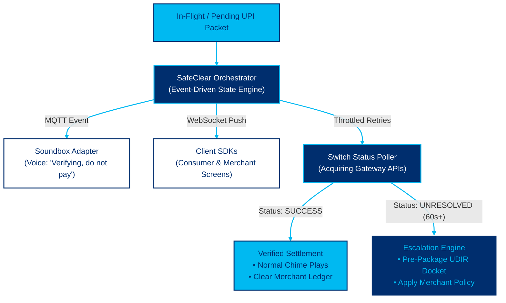

# Paytm SafeClear: Comprehensive Hackathon Strategy & Pitch Playbook

**Event:** Paytm Build for India AI Hackathon – Delhi Edition  
**Venue:** Paytm, SkymarkOne, Sector 98, Noida, Uttar Pradesh 201304  
**Track:** [Track 3: Autonomous AI Teammates](file:///Users/test/Documents/paytm/Problem%20statement%203.pdf)  
**Team:** Team Ok Paytm  
**Status:** Pitch Deck Submitted | Preparing for Offline Round (October 30, 2026)

---

## Table of Contents
1. [Hackathon Overview & Track Analysis](#1-hackathon-overview--track-analysis)
2. [Idea Evolution & Killing the Generic Concepts](#2-idea-evolution--killing-the-generic-concepts)
3. [The Problem: Point-of-Sale Payment Ambiguity](#3-the-problem-point-of-sale-payment-ambiguity)
4. [The Critical Architecture Review: From Flawed to Defensible](#4-the-critical-architecture-review-from-flawed-to-defensible)
5. [The Submitted 7-Slide Pitch Deck](#5-the-submitted-7-slide-pitch-deck)
6. [Slide 4 Architecture Diagram & Visual Specification](#6-slide-4-architecture-diagram--visual-specification)
7. [Judge's Critique & The 3 Killer Defense Answers](#7-judges-critique--the-3-killer-defense-answers)
8. [The October 30 Offline Demo Specification (3-Scenario Simulator)](#8-the-october-30-offline-demo-specification-3-scenario-simulator)

---

## 1. Hackathon Overview & Track Analysis

### Event Details
* **Organizers:** Paytm Community in collaboration with devSemble.
* **Stage 1 (Pitch Submission):** 7-Slide PPT Pitch Deck based on strict structure (Title, Problem, Solution, Tech Stack, USP, Impact, Business Model).
* **Stage 2 (Offline Hackathon):** In-person building and live demonstration at Paytm HQ in Noida on October 30, 2026.
* **Incentives:** Hiring opportunities with Paytm engineering/product teams, monetary prizes, recognition.

### The 3 Hackathon Problem Statements
1. **Track 1: Merchant Growth AI** — *"Build the AI business partner for every Paytm merchant beyond payments."*
2. **Track 2: AI-Powered Financial Journeys** — *"Make Insurance, Lending and Fintech simpler, faster and more human."*
3. **Track 3: Autonomous AI Teammates (Selected)** — *"Build AI teammates that don’t just respond; they get the job done. Design an AI teammate that can independently handle a workflow end-to-end — resolving issues, taking actions across systems, and escalating only when needed."*

---

## 2. Idea Evolution & Killing the Generic Concepts

During strategy sessions, several conventional ideas were evaluated and rejected for being derivative or technically unrealistic:
* **Rejected:** *Handwritten Khata Scanner + WhatsApp Reminder* (Solved by Khatabook/OkCredit in 2019; generic hackathon trope).
* **Rejected:** *Inventory Markdown & Discount Calculator* (Standard MBA/Kaggle project with no Paytm hardware moat).
* **Rejected:** *Ambient Camera Counter Surveillance / Visual Loss Prevention* (Unrealistic in noisy, cluttered Indian street retail; fails live demo).
* **Rejected:** *AI Credit Scoring / Document KYC Checker* (Handled by standard verification vendors like IDfy/Karza; low novelty).
* **The Breakthrough Selection:** **Paytm SafeClear** — Tackling the 60 seconds of counter chaos when a UPI payment is debited from the customer but unconfirmed at the merchant Soundbox.

---

## 3. The Problem: Point-of-Sale Payment Ambiguity

### The Counter Standoff ("Paisa Kat Gaya Par Mila Nahi")
* A customer scans a QR code, enters their UPI PIN, and receives a bank debit SMS.
* The Paytm app shows `PENDING / PROCESSING` with an endless spinner.
* The merchant's Paytm Soundbox remains **completely silent** (by design, it only announces verified success).
* **The Fallout:**
  1. **The Standoff:** The merchant cannot release goods without confirmation; the customer refuses to pay twice.
  2. **Accidental Duplicate Payments:** Panicked customers scan and pay again, often causing double debits and doubling dispute loads.
  3. **Queue Paralysis:** Merchants must pause operations to open their business app and manually refresh transaction history.
  4. **The Latency Mismatch:** NPCI UDIR and RBI guidelines resolve failed transactions over T+1 to T+5 days at midnight, which is useless at a physical counter during peak retail hours.

---

## 4. The Critical Architecture Review: From Flawed to Defensible

An honest technical audit revealed critical flaws in naive approaches, which were systematically corrected:

### Flaw 1: Trusting Surrogate Evidence
* *Initial Idea:* Using SMS text, Bluetooth proximity, and a 96% AI confidence score to declare a payment successful.
* *Correction:* **Surrogate evidence is not settlement.** An SMS can be spoofed, or a genuine debit can fail downstream. SafeClear strictly relies on **authoritative switch records**; the AI coordinates the incident lifecycle rather than guessing financial outcomes.

### Flaw 2: The Unfunded Financial Guarantee
* *Initial Idea:* Having Paytm automatically front money to the merchant on pending payments, relying on UPI AutoPay to claw it back if the bank reverses.
* *Correction:* An AI cannot gamble company balance sheets on a confidence score without an explicit, regulated protection fund. SafeClear was reframed around **orchestrating authorized verification and duplicate prevention**, with merchant protection treated as an optional, separately funded commercial policy.

### Flaw 3: Universal QR Lockout Assumptions
* *Initial Idea:* Claiming WebSockets lock the QR code for 90 seconds.
* *Correction:* You cannot lock a physical printed acrylic standee or prevent scans from Google Pay/PhonePe. The feature was positioned as **active friction and clear holding warnings within supported Paytm interfaces**.

---

## 5. The Submitted 7-Slide Pitch Deck

### Slide 1: Title Slide
* **Title:** PAYTM SAFECLEAR
* **Subtitle:** An Autonomous Incident Resolution Teammate for Ambiguous Point-of-Sale UPI Transactions
* **Track:** Track 3: Autonomous AI Teammates
* **Team:** By Team Ok Paytm

### Slide 2: What's the Problem?
* **The Counter Friction:** When a UPI payment attempt results in an in-flight, pending, or timeout status, existing systems leave the counter in an operational vacuum:
  * The Soundbox remains silent (it is architected to announce verified successes only).
  * The customer fears an unconfirmed debit; the merchant cannot release goods without verification.
* **The Fallout:**
  * **Accidental Duplicate Payments:** Confused customers frequently scan and pay again, often creating a double debit and compounding dispute volume.
  * **Queue Delays & Manual Overhead:** Merchants must interrupt their workflow to manually open their business app, locate the transaction, and refresh status.
  * **Delayed Recourse:** While NPCI's UDIR framework and RBI guidelines resolve failed transactions over subsequent business days, there is no autonomous coordination at the physical point of sale during the incident itself.

### Slide 3: Proposed Solution
1. **Immediate Multi-Interface Communication:** When an ambiguous payment outcome occurs, SafeClear immediately issues clear audio and visual alerts on supported interfaces (*"Payment verification in progress — please do not pay again yet"*), defusing tension and preventing panic retries.
2. **Authoritative Status Orchestration:** Instead of requiring manual app polling, the agent coordinates throttled, authorized status inquiries against the acquiring switch and available status APIs.
3. **Duplicate Payment Guard:** Displays persistent visual holding states on the Paytm customer and merchant screens to discourage immediate re-scans.
4. **Automated Escalation & Docketing:** If status remains unresolved after verified retries, the agent pre-packages an authenticated dispute docket (capturing client reference, timestamps, and terminal telemetry) ready for authorized UDIR submission, or applies contractually defined, pre-funded merchant protection rules where available.

### Slide 4: Tech Stack & Architecture
*(Visual layout: Left-hand concise cards + Right-hand Paytm palette architecture diagram)*
* **State Core (FastAPI + Redis):** Event-driven state machine managing active incidents with sub-100ms response time.
* **Dual-Channel Counter Sync:** Soundbox speaks warning (MQTT) + app screens lock (WebSockets) to stop duplicate payments.
* **Authoritative Switch Poller:** Automates background gateway status checks without manual merchant refreshing.
* **Automated Dispute Docketing:** Auto-compiles verified UTR/telemetry data for instant NPCI UDIR escalation after 60s.

### Slide 5: USP (Unique Selling Proposition)
1. **Orchestration Over Speculation:** SafeClear does not gamble on artificial confidence scores or fake SMS receipts; it operates strictly on authoritative verification and defined policy rules.
2. **Incident Lifecycle Ownership:** Bridges the gap between the moment a payment hangs and when back-office dispute systems take over.
3. **Active Duplicate Prevention:** The first counter system designed specifically to prevent accidental double-spend attempts during network latency.
4. **Zero Manual Investigation for Merchants:** Turns an active queue interruption into an automated, background-monitored task.

### Slide 6: Impact & Benefits
* **Reduced Resolution Time:** Eliminates manual navigation and status refreshing on the merchant app during peak rush hours.
* **Lowered Dispute Volume:** Preventing accidental duplicate payments directly reduces the downstream reconciliation workload for banks and customer care.
* **Preserved Trust:** Clear, automated communication eliminates awkward customer-merchant standoffs during bank server latency.
* **Audit-Ready Escalations:** Pre-packaged dispute dockets ensure that any escalation to UDIR contains validated transaction references and telemetry, cutting human dispute investigation time.

### Slide 7: Business Model & Rollout
* **Core Value for Paytm:**
  * Direct reduction in tier-1 customer support tickets related to in-flight payment inquiries and duplicate debits.
  * High-value differentiator for the Paytm for Business ecosystem, reinforcing merchant reliance on Paytm hardware and apps.
* **Phase 1 (Software Only):** Real-time duplicate alerts on the Paytm Consumer App + automated status monitoring on the Paytm for Business App.
* **Phase 2 (Hardware Integration):** Firmware adapter rollout to the Soundbox fleet for verbal incident de-escalation.
* **Phase 3 (Enterprise Merchant Protection):** Optional integration with commercially backed merchant-protection programs for high-volume retail chains.

---

## 6. Slide 4 Architecture Diagram & Visual Specification

### Brand Palette
* **Deep Navy:** `#002E6E`
* **Paytm Cyan:** `#00B9F1`
* **Pure White:** `#FFFFFF`

### Mermaid Diagram Source

---

## 7. Judge's Critique & The 3 Killer Defense Answers

When presenting live at Paytm HQ on October 30, judges will test the team with three specific questions. Use these battle-tested responses:

### Question 1: *"Can you actually access the payment systems you claim to orchestrate?"*
> **Answer:** *"No. As hackathon builders, we do not possess live credentials for Paytm’s acquiring switches or core NPCI rails. Our architecture introduces an **Authoritative Integration Adapter**. In our demo today, this adapter interfaces with a simulated gateway and mock status APIs. In production, this would sit as an internal Paytm microservice hooking into native transaction polling services and authorized UDIR connectors. We built the incident orchestration layer, not the banking switch."*

### Question 2: *"Does your solution prevent duplicate payments, or merely warn people not to retry?"*
> **Answer:** *"We cannot physically lock down a printed acrylic standee or third-party apps like Google Pay. SafeClear provides **active friction and containment within supported Paytm interfaces**:  
> 1. A persistent holding state on the consumer app: 'Payment verification in progress — do not pay again.'  
> 2. Real-time updates to the Merchant App and Soundbox so the shopkeeper does not instruct the customer to retry.  
> Our goal is reducing accidental retries through proactive communication, not claiming universal control over external UPI apps."*

### Question 3: *"Where is the autonomous intelligence beyond a conventional event-driven workflow?"*
> **Answer:** *"A simple state machine only works when inputs and timelines are deterministic. In counter ambiguity, inputs are asynchronous and noisy. SafeClear's agent provides **operational decision-making under uncertainty**:  
> 1. **Adaptive Polling:** Dynamically tunes retry intervals and backoff policies based on switch error codes (e.g., HTTP 504 vs. bank-switch timeout).  
> 2. **Context-Aware Communication:** Synthesizes natural vernacular speech for the Soundbox and app screens tailored to the specific failure context.  
> 3. **Intelligent Escalation Routing:** When retries expire, it evaluates transaction parameters to route to automated UDIR docket packaging or flag for operational review.  
> The agent does not guess financial outcomes—it manages the incident lifecycle and executes permitted actions."*

---

## 8. The October 30 Offline Demo Specification (3-Scenario Simulator)

To win the offline round, build a clean, self-contained interactive demo modeling the **3 fundamental real-world outcomes**:

### Screen Layout for the Demo
* **Left Screen (Customer & Merchant Experience):**
  * Mobile view (Customer Paytm app showing QR scan and holding state).
  * Tablet/Desktop view (Merchant Paytm for Business app + Soundbox audio trigger).
* **Right Screen (The Agent's Mind & Event Stream):**
  * Live terminal showing state transitions, retry intervals, telemetry logs, and JSON payloads.

### The 3 Core Test Scenarios to Demonstrate
1. **Scenario 1: Verified Success (Late Callback)**
   * Trigger in-flight transaction $\rightarrow$ Soundbox speaks *"Verifying, please do not pay again"* $\rightarrow$ Holding screen appears $\rightarrow$ Mock switch returns `SUCCESS` after 15s $\rightarrow$ Normal chime sounds, merchant ledger credits, customer screen turns green.
2. **Scenario 2: Verified Failure (Decline by Issuer)**
   * Trigger in-flight transaction $\rightarrow$ Soundbox warns against duplicate payment $\rightarrow$ Mock switch returns `DECLINED (Insufficient Funds / Wrong PIN)` after 20s $\rightarrow$ Soundbox explains decline; customer screen prompts to retry with alternative method.
3. **Scenario 3: Unresolved Timeout (Escalation)**
   * Trigger in-flight transaction $\rightarrow$ Bank switch remains unresponsive after 3 exponential retries (60s) $\rightarrow$ Agent terminates polling $\rightarrow$ Automatically compiles timestamped, signed JSON dispute docket ready for NPCI UDIR submission $\rightarrow$ Instructs customer on next steps with guaranteed dispute tracking ID.
